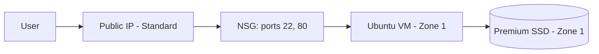

# Azure VM in Availability Zone 1

## Overview
A Linux VM created in **Availability Zone 1** on Azure. A zone is a separate datacenter inside a region, so the VM is protected from a single datacenter failure.

## Architecture


## Real-Time Process
1. User sends a request to the public IP
2. NSG allows ports 22 and 80
3. VM in Zone 1 responds with the Nginx page

## Steps
1. Create Resource Group `rg-az-lab`
2. Create VM, choose **Availability zone → Zone 1**
3. Ubuntu 22.04, Standard_B2s, SSH key
4. Use a Standard public IP, allow ports 22 and 80
5. Verify: VM → Overview → Properties → Zone = 1
6. SSH in and install Nginx

## Commands
```bash
az group create --name rg-az-lab --location centralindia
az vm create --resource-group rg-az-lab --name vm-zone1 \
  --image Ubuntu2204 --size Standard_B2s --zone 1 \
  --admin-username azureuser --generate-ssh-keys --public-ip-sku Standard
az vm open-port -g rg-az-lab -n vm-zone1 --port 80
sudo apt update && sudo apt install nginx -y
```

## Cleanup
```bash
az group delete --name rg-az-lab --yes --no-wait
```

## Tools Used
Azure Portal / CLI, Ubuntu, SSH, Nginx

## Author
Saranya T
